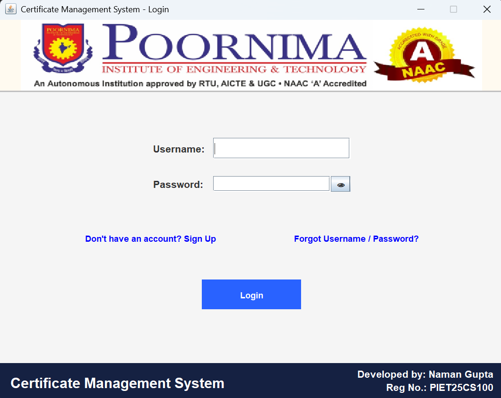
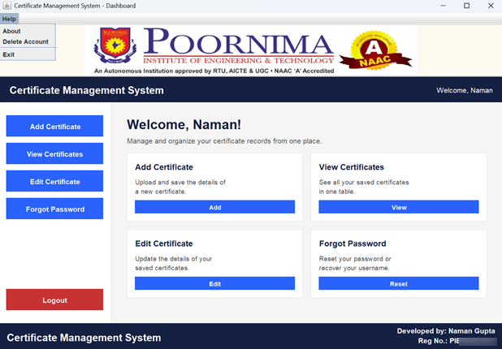
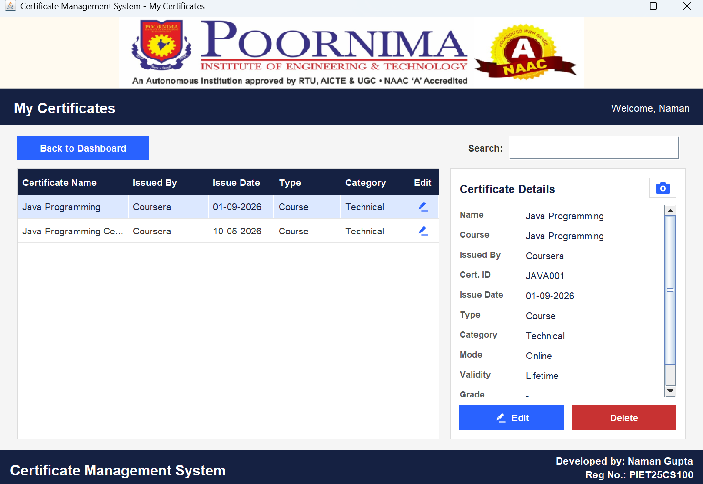
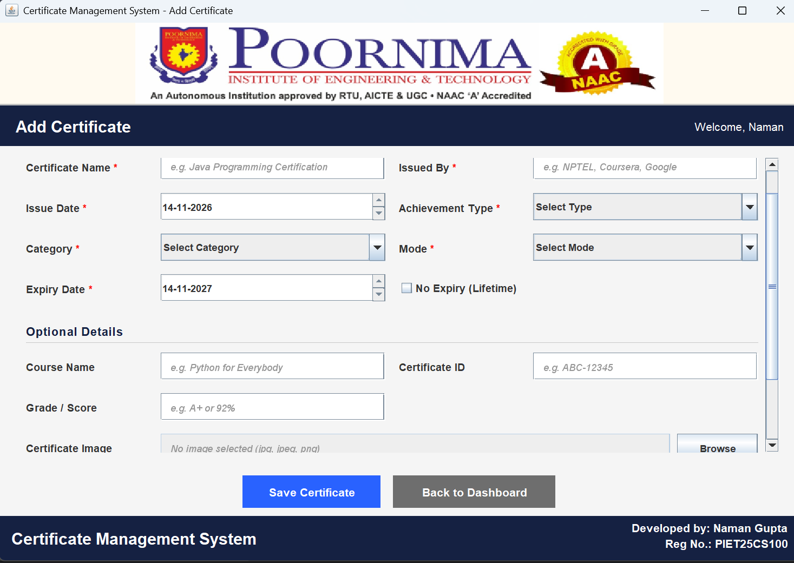
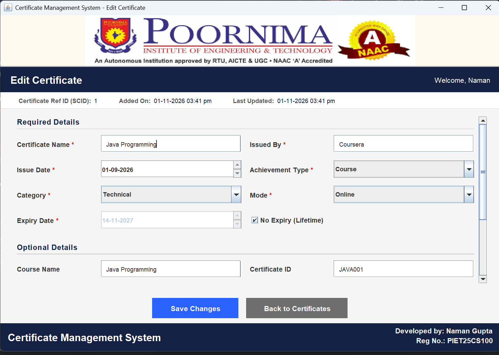
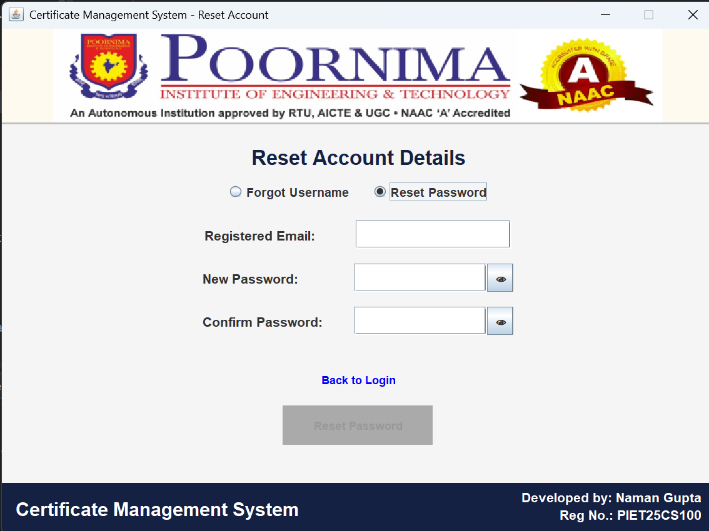
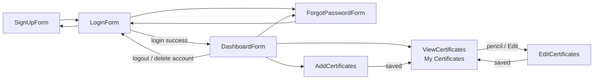
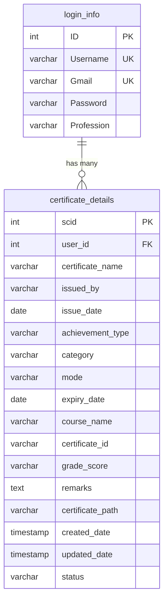

# Certificate Management System


A desktop application built with **Java Swing** and **MySQL** that lets every user digitally store, organize, search, update and delete their personal certificates (courses, internships, workshops, hackathons, competitions and more) from one place.

Each user has a private account and can only see and manage **their own** certificates.
Developed as a **Mini Project** at Poornima Institute of Engineering & Technology (PIET).

---

## Table of Contents

- [About the Project](#about-the-project)
- [Features](#features)
- [Screenshots](#screenshots)
- [Technology Stack](#technology-stack)
- [Application Flow](#application-flow)
- [Project Structure](#project-structure)
- [What Each File Does](#what-each-file-does)
- [Database Design](#database-design)
- [Getting Started](#getting-started)
- [How to Use the Application](#how-to-use-the-application)
- [Validation Rules](#validation-rules)
- [Security Notes](#security-notes)
- [Known Limitations](#known-limitations)
- [Future Scope](#future-scope)
- [Contributing](#contributing)
- [Author](#author)

---

## About the Project

Certificates earned from courses, internships, workshops and competitions usually end up scattered across phone galleries, e-mails and folders. It is hard to find them later, and easy to forget when one expires.

The **Certificate Management System (CMS)** solves this by giving every user one secure place to:
- keep all certificate details together,
- search and sort them quickly,
- see automatically how much validity is left on each certificate,
- update or remove records whenever needed.

The project follows a simple desktop-application structure: Swing screens for the user interface and JDBC for talking to a MySQL database.

---

## Features

### Authentication and Account

- **Sign Up** with Gmail address, username, password and profession (Student / Working Professional / Other)
- **Login** with username and password, checked against the database
- **Forgot Username** and **Reset Password** recovery using the registered Gmail address
- **Show / hide password** button on every password field
- **Real-time validation** with clear red error messages; the action button stays disabled until the details are valid
- **Logout** returns to the Login screen

### Dashboard

- Welcome message with the logged-in username
- Sidebar navigation: Add Certificate, View Certificates, Edit Certificate, Forgot Password, Logout
- Four quick-action cards for the same actions
- **Help menu** with **About**, **Delete Account** and **Exit**

### Certificate Management (Create, Read, Update, Delete)

- **Add** a certificate with required details (name, issuer, issue date, achievement type, category, mode, expiry) and optional details (course name, certificate ID, grade / score, remarks, certificate image)
- **No Expiry (Lifetime)** option for certificates that never expire
- **View** all your certificates in a table with:
  - live **search** (name, issuer, date, type, category, mode, course, certificate ID and grade)
  - **sorting** by clicking any column header
  - a **details panel** that shows the full information of the selected certificate in read-only form
  - a **pencil icon** on every row to edit that certificate directly
- **Validity is calculated automatically** from the expiry date and shown as *Lifetime*, *Expired*, or the time left (for example "2 Years 4 Months left")
- **Edit** a certificate in a pre-filled form. System details such as the certificate reference ID (SCID), created time and last updated time are shown but cannot be changed
- **Delete** a certificate after a confirmation prompt

### Data Safety

- Every certificate is linked to its owner through `user_id`, so users can only view, edit and delete **their own** records
- **Delete Account** is protected by three steps: confirmation, password check, and a final "cannot be undone" confirmation
- Deleting an account also removes all certificates of that user, and both deletions happen together as one database transaction (either everything is deleted or nothing is)

---

## Screenshots

| Login | Dashboard |
|:---:|:---:|
|  |  |

|                   My Certificates                   |                  Add Certificate                   |
|:---------------------------------------------------:|:--------------------------------------------------:|
|  |  |

|                   Edit Certificate                    |              Forgot Password               |
|:-----------------------------------------------------:|:------------------------------------------:|
|  |  |

---

## Technology Stack

| Category | Technology |
|---|---|
| Programming language | Java ( JDK 17 or newer recommended) |
| User interface | Java Swing and AWT |
| Database | MySQL 8.0 |
| Database connectivity | JDBC with MySQL Connector/J |
| IDE | IntelliJ IDEA |
| Version control | Git and GitHub |

**Java and Swing concepts used**

- Object-oriented programming (classes, encapsulation, reusable components)
- Swing components: `JFrame`, `JPanel`, `JTable`, `JComboBox`, `JSpinner`, `JTextArea`, `JScrollPane`, `JOptionPane`, `JFileChooser`
- Layout managers: `BorderLayout`, `GridBagLayout`, `CardLayout`, `BoxLayout`, `GridLayout`, `FlowLayout`
- Event handling with listeners and lambda expressions
- `TableRowSorter` and `RowFilter` for sorting and live search in tables
- JDBC with `PreparedStatement` (parameterized queries) and transactions
- `java.time` API (`LocalDate`, `Period`) for date handling and validity calculation
- Custom painted icon using `Graphics2D`

---

## Application Flow



The logged-in **username is passed from screen to screen** through constructors. Whenever a screen needs the user's ID, it looks it up from the `login_info` table using that username.

---

## Project Structure

```
certificate-management-system/
├── database/
│   └── schema.sql                          # Database structure (no data)
├── screenshots/                            # Images used in this README
├── src/
│   ├── CertificateManagementSystem.java    # Main class (entry point)
│   ├── Common/
│   │   ├── Header.java                     # Reusable top banner
│   │   ├── Footer.java                     # Reusable bottom bar
│   │   └── college_logo.png                # College logo used in the header
│   ├── DatabaseConnectivity/
│   │   └── dbConnect.java                  # MySQL connection (add your username and password)
│   ├── LoginFiles/
│   │   ├── LoginForm.java                  # Login screen
│   │   ├── SignUpForm.java                 # Registration screen
│   │   └── ForgotPasswordForm.java         # Forgot username / reset password
│   └── Files/
│       ├── DashboardForm.java              # Home screen after login
│       ├── AddCertificates.java            # Add certificate
│       ├── ViewCertificates.java           # My Certificates (list, search, details, delete)
│       ├── EditCertificates.java           # Edit certificate
│       └── CertificateFormPanel.java       # Form shared by Add and Edit
├── .gitignore
└── README.md
```

---

## What Each File Does

### Entry point

| File | Purpose |
|---|---|
| `CertificateManagementSystem.java` | Main class. Run this file to start the application; it opens the Login screen. |

### `Common` package (shared UI parts)

| File | Purpose |
|---|---|
| `Header.java` | Builds the top banner with the college logo. The same header is reused on every screen. |
| `Footer.java` | Builds the bottom bar with the project name and developer details. Reused on every screen. |
| `college_logo.png` | Logo image shown in the header. |

### `DatabaseConnectivity` package

| File | Purpose |
|---|---|
| `dbConnect.java` | The only place where the MySQL connection is created. Every screen calls `dbConnect.getConnection()` to talk to the database. **You must put your own MySQL username and password here** (see [Getting Started](#getting-started)). |

### `LoginFiles` package (accounts)

| File | Purpose |
|---|---|
| `LoginForm.java` | Takes username and password, checks them in the `login_info` table, shows clear messages for "no user found" and "wrong password", and opens the Dashboard with the logged-in username. Has links to Sign Up and Forgot Username / Password. |
| `SignUpForm.java` | Registration form (Gmail, username, password, confirm password, profession) with real-time validation. The Register button is enabled only when every field is valid. |
| `ForgotPasswordForm.java` | Account recovery. A radio button switches between **Forgot Username** (enter the registered Gmail to get your username) and **Reset Password** (verify the registered Gmail and set a new password). |

### `Files` package (dashboard and certificates)

| File | Purpose |
|---|---|
| `DashboardForm.java` | Home screen: sidebar, welcome message, quick-action cards and the Help menu (About, Delete Account, Exit). Also contains the Delete Account logic (confirm, password check, final confirm, then delete the user's certificates and account in one transaction). |
| `AddCertificates.java` | Page for adding a new certificate. Validates the form and saves it to the `certificate_details` table for the logged-in user. |
| `ViewCertificates.java` | The **My Certificates** page. Loads only the logged-in user's certificates into a table, with live search, column sorting, a read-only details panel with automatic validity calculation, a pencil icon for editing, and a Delete button with confirmation. |
| `EditCertificates.java` | Page for updating a certificate. Pre-fills all editable fields from the database and shows SCID, created time and last updated time as read-only information. |
| `CertificateFormPanel.java` | The form used by both Add and Edit pages, so the fields and validation exist in only one place. It also converts the form values into SQL parameters and finds the user ID of the logged-in username. |

### Other files

| File | Purpose |
|---|---|
| `database/schema.sql` | Creates the database and both tables. Contains the structure only, no data. |
| `.gitignore` | Tells Git which files to skip (IDE settings, compiled output and similar). |
| `screenshots/` | Images shown in this README. |

---

## Database Design

Database name: **`certificate_management_system`**



**Relationship:** one user can have many certificates (`login_info.ID` to `certificate_details.user_id`).


## Getting Started

### Prerequisites

- **JDK 8 or newer** (JDK 17 or newer recommended)
- **MySQL Server 8.0 or newer**, running on your computer
- **MySQL Connector/J** (the JDBC driver `.jar` file): [download here](https://dev.mysql.com/downloads/connector/j/) and choose "Platform Independent"
- **IntelliJ IDEA** (recommended), Eclipse or NetBeans
- **Git** (only if you want to clone the repository from the command line)

### Step 1: Get the code

Clone the repository:

```bash
git clone https://github.com/YOUR_GITHUB_USERNAME/certificate-management-system.git
```

If you want your own copy to make changes, click **Fork** on the GitHub page first and clone your fork. You can also use **Code → Download ZIP** and extract it.

Then open the project folder in IntelliJ IDEA.

### Step 2: Create the database (required)

> **Forking or cloning copies only the code, not the database.** Every person who runs the project must create the database on their own MySQL server. The file `database/schema.sql` does this for you: it creates the database `certificate_management_system` and both tables.

**Option A: MySQL Workbench**

1. Open MySQL Workbench and connect to your local server.
2. Go to **File → Open SQL Script** and select `database/schema.sql`.
3. Click the lightning bolt icon to run the whole script.
4. Refresh the Schemas list. You should see `certificate_management_system` with the tables `login_info` and `certificate_details`.

**Option B: Command line**

```bash
mysql -u root -p < database/schema.sql
```

Enter your MySQL password when asked.

Please note:

- The script contains **no data**, so there are no ready-made users. After starting the app, create your own account from the **Sign Up** screen.
- The script uses `DROP TABLE IF EXISTS`, so run it on a **fresh setup**. If tables with the same names already exist, they will be recreated and their data will be lost.

### Step 3: Add your MySQL username and password

The repository does not contain anyone's real password. Open this file:

```
src/DatabaseConnectivity/dbConnect.java
```

You will find placeholders for the database login. **Replace them with your own MySQL username and password** (the username is usually `root`; the password is the one you set while installing MySQL).

Also check the connection URL in the same file. With a default MySQL installation it looks like this:

```
jdbc:mysql://localhost:3306/certificate_management_system
```

Change `localhost` or `3306` only if your MySQL server runs on a different host or port. Keep the database name `certificate_management_system`, because that is the name created by `schema.sql`.

> **Important:** Do not push your real password to GitHub. If you plan to commit your own changes, tell Git to stop tracking your local edits of this file:
>
> ```bash
> git update-index --skip-worktree src/DatabaseConnectivity/dbConnect.java
> ```

### Step 4: Add the MySQL driver

In IntelliJ IDEA:

1. Go to **File → Project Structure → Libraries**.
2. Click **+ → Java** and select the downloaded `mysql-connector-j-x.x.x.jar`.
3. Click **OK** and apply.

(In Eclipse: right-click the project → Build Path → Add External JARs. In NetBeans: right-click Libraries → Add JAR/Folder.)

Also make sure the `src` folder is marked as a **Sources Root** (right-click `src` → Mark Directory as → Sources Root), so the logo image is available at runtime.

### Step 5: Run the project

Open `src/CertificateManagementSystem.java` and run it. The **Login** screen will appear.

### Troubleshooting

| Problem or message | Likely cause and fix |
|---|---|
| `Database Error!` dialog on login | The app cannot reach the database. Check the rows below. |
| `Access denied for user 'root'@'localhost'` | Wrong MySQL username or password in `dbConnect.java`. |
| `Communications link failure` | MySQL server is not running, or the host or port in the URL is wrong. |
| `Unknown database 'certificate_management_system'` | The database has not been created. Run `database/schema.sql` (Step 2). |
| `Table '...' doesn't exist` | The tables are missing. Run `database/schema.sql` again on a fresh setup. |
| `No suitable driver` or `ClassNotFoundException: com.mysql.cj.jdbc.Driver` | MySQL Connector/J is not added to the project libraries (Step 4). |
| College logo is not visible in the header | Mark `src` as **Sources Root** and rebuild the project. |
| Login says "No User Found" | The database is empty. Create an account from the Sign Up screen first. |

---

## How to Use the Application

1. **Sign Up:** enter a Gmail address, a username, a password (twice) and choose your profession. Click **Register**.
2. **Login:** enter your username and password. The Dashboard opens with your name.
3. **Add a certificate:** click **Add Certificate**, fill in the required fields (marked with a red star), add optional details if you like, and click **Save Certificate**. If the certificate never expires, tick **No Expiry (Lifetime)**.
4. **View your certificates:** click **View Certificates**. Use the **Search** box at the top right to filter, and click a column header to sort.
5. **See full details:** click any row. The right-hand panel shows all the information, including the calculated validity.
6. **Edit a certificate:** click the **pencil icon** on the row, or select the row and click **Edit**. Change the details and click **Save Changes**.
7. **Delete a certificate:** select the row and click **Delete**, then confirm.
8. **Recover your account:** on the Login screen click **Forgot Username / Password?** to get your username or set a new password.
9. **Delete your account:** go to **Help → Delete Account**, confirm, enter your password, and confirm once more. All your certificates are removed with the account.
10. **Logout / Exit:** use **Logout** in the sidebar, or **Help → Exit** to close the program.

---

## Validation Rules

| Field | Rule |
|---|---|
| Email | Must be a valid Gmail address (`name@gmail.com`) |
| Username | Letters, numbers and underscore only, fewer than 20 characters |
| Password | At least 6 characters with 1 uppercase letter, 1 lowercase letter and 1 number |
| Confirm Password | Must match the password |
| Certificate Name and Issued By | Required, up to 100 characters each |
| Issue Date | Required, cannot be in the future |
| Achievement Type, Category and Mode | Must be selected from the dropdowns |
| Expiry Date | Must be after the issue date, or tick **No Expiry (Lifetime)** |
| Course Name | Optional, up to 100 characters |
| Certificate ID | Optional, up to 50 characters |
| Grade / Score | Optional, up to 30 characters |
| Remarks | Optional, up to 255 characters |

---

## Security Notes

- All database queries use **`PreparedStatement`** with parameters, which protects against SQL injection.
- Every certificate query is filtered by the logged-in user's ID, so one user cannot read or change another user's certificates.
- Destructive actions (delete certificate, delete account) always ask for confirmation, and account deletion also needs the password.
- Database credentials are kept out of the repository. Add your own locally and never commit them.

---

## Known Limitations

- Passwords are stored as **plain text** in the database. A production system should store a salted hash (for example BCrypt). This would also need a longer `Password` column, which is currently `VARCHAR(30)`.
- For an attached certificate image, only the **file path** is saved, not the file itself. If the original file is moved or deleted, the link breaks.
- Forgot Password / Forgot Username verify the user by the registered Gmail address only (no e-mail OTP).
- The screens contain both the user interface and the database code. A larger version could separate them into different layers.
- It is a single-computer desktop application; there is no multi-device sync.

---

## Future Scope

- Password hashing (BCrypt) and e-mail OTP for account recovery
- Copying uploaded certificate files into an application folder so links never break
- Export certificates to PDF or Excel
- Reminders for certificates that are about to expire
- Separate data-access layer (DAO) for cleaner code

---

## Contributing

1. Fork the repository.
2. Create a new branch: `git checkout -b feature/your-feature-name`
3. Make your changes and commit them: `git commit -m "Add your feature"`
4. Push the branch and open a Pull Request.

Please do not include your database password in any commit.

---

## Author

**Naman Gupta**
GitHub: [@NamanG-23](https://github.com/NamanG-23)

---

This is an educational mini project. Feel free to use it as a reference for learning Java Swing and JDBC.
